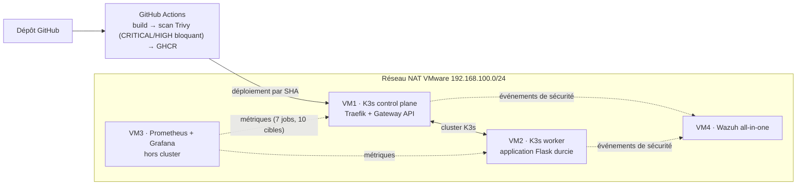

<!-- README de profil : mohNetcyber/mohNetcyber -->
<!-- Dépendances tierces : voir le tableau "Widget / Repli" fourni séparément -->

 

---

## 👤 À propos

- Étudiant ingénieur **GSCSI** (Systèmes Communicants & Sécurité Numérique) à l'**ENSA Fès**, Maroc.
- Je cherche un **stage réseaux informatiques / sécurité réseau / SOC / DevSecOps / infrastructure**.
- Stage 2026 au labo **LIASSE** : déploiement et supervision sécurisée d'un mini-cloud privé virtualisé (projet en binôme, détails plus bas).
- Côté réseaux : conception et simulation d'architectures multi-sites, **routage dynamique (OSPF, BGP)** et **dual-stack IPv4 / IPv6** sous GNS3.
- Côté systèmes : déploiement d'un **domaine Active Directory** complet (2 contrôleurs de domaine, GPO, DNS/DHCP/DFS) segmenté en **VLAN** derrière un pare-feu **pfSense**.
- Certifié **Cisco CCNA Automation** (2026) et **CyberOps Associate** (2025).

> 🇬🇧 **In short:** engineering student (GSCSI, ENSA Fès) focused on computer networking, network security, SOC and DevSecOps.
> I build and monitor small secure infrastructures, and I am looking for an internship in networking / SOC / DevSecOps / network security.

---

## 🛠️ Compétences

**Réseau**  

-0D1117?style=flat-square&logoColor=00D4FF)

**Systèmes & annuaire**  

**Sécurité & SOC**  

**Cloud & DevOps**  

-0D1117?style=flat-square&logo=kubernetes&logoColor=00D4FF)

**Scripting**  

**Supervision & outils**  

---

## 🎓 Certifications

| Certification | Organisme | Année |
|---|---|:---:|
|  | Cisco | 2026 |
|  | Cisco | 2025 |
|  | Internet Society | 2025 |
|  | Internet Society | 2025 |

<!-- <A_COMPLETER> : ajouter les liens de vérification des certificats (ex. Credly) -->

---

## 🚀 Projet phare : mini-cloud-config

**[Déploiement et supervision sécurisée d'un mini-cloud privé virtualisé](https://github.com/mohNetcyber/mini-cloud-config)**  
Stage réalisé au labo LIASSE (ENSA Fès) en juillet-août 2026, sous l'encadrement de **Pr. Marwa Boumaiz**.

> 🤝 **Projet réalisé en binôme avec [El Mahdi Karym](https://github.com/mehdi192837465).**  
> Sa part : **Wazuh** et **Grafana**.  
> Ma part : **déploiement de la plateforme, K3s, Prometheus et scénarios de test**.

### Architecture

Supervision (VM3) volontairement hors cluster pour survivre à une panne de celui-ci. Flux en pointillé : supervision et sécurité.

### Composants

| Composant | Rôle | Techno |
|---|---|---|
| Orchestration | Cluster Kubernetes léger (control plane VM1, worker VM2) | K3s |
| Exposition | Ingress, redirection HTTP → HTTPS | Traefik + Gateway API |
| Provisioning | Déploiement idempotent, secrets chiffrés | Ansible + Ansible Vault |
| Application | Service durci : `runAsNonRoot`, `readOnlyRootFilesystem`, capabilities `drop ALL`, isolation réseau | Flask, NetworkPolicy |
| Métriques & alertes | 7 jobs, 10 cibles, 4 alertes | Prometheus |
| Visualisation | 9 panneaux | Grafana |
| Détection (SIEM/XDR) | Force brute SSH, FIM, audit API Kubernetes, SCA CIS Ubuntu 24.04, réponse active `firewall-drop` | Wazuh |
| CI/CD & supply chain | Build, scan bloquant CRITICAL/HIGH, publication, déploiement par SHA, mises à jour auto | GitHub Actions, Trivy, GHCR, Dependabot |

### Scénarios de test (résultats mesurés)

| Scénario | Résultat mesuré |
|---|---|
| Arrêt d'un service (alerte `ServiceDown`) | détection ≈ **101 s** |
| Coupure réseau VM1 ↔ VM2 | détection ≈ **87–102 s** |
| Suppression d'un pod | recréé et *Ready* en **8 s** |
| Force brute SSH | détection **immédiate** (Wazuh) |
| Modification de fichier surveillé (FIM) | détection **quasi instantanée** (Wazuh) |

**Correspondance MITRE ATT&CK** *(suggestion, à vérifier selon la version du référentiel)* :
`T1110` force brute (SSH) · `T1609` exécution dans un conteneur (`pods/exec`) · `T1552.007` accès aux Secrets Kubernetes.

### Limites assumées

Un seul control plane · pas d'Alertmanager ni de sauvegarde · runner CI partagé avec le control plane · certificats auto-signés.
Ces points figurent dans ma feuille de route.

📄 **[Rapport de stage (PDF)](https://github.com/mohNetcyber/mini-cloud-config/blob/main/docs/rapport-stage.pdf)** · 💻 **[Code source](https://github.com/mohNetcyber/mini-cloud-config)**

---

## 🌐 Projet réseau : Lab eBGP / iBGP (IPv4 + IPv6)

**[lab-ebgp-ibgp-gns3](https://github.com/mohNetcyber/lab-ebgp-ibgp-gns3)**  
*Problème :* maîtriser le routage inter-AS et la façon dont un AS se présente au reste du réseau, en dual-stack.  
*Solution :* réseau de **3 systèmes autonomes** (AS 65000 / 65001 / 65002) sous **GNS3** (routeurs Cisco c7200, IOU L3 15.2d), documenté et reproductible (configurations par étape, README détaillé, captures).

| Brique | Ce que j'ai mis en œuvre |
|---|---|
| IGP | **OSPFv3 par Address-Families** (IPv4 + IPv6 dans un seul processus) pour la joignabilité interne |
| eBGP | Sessions entre AS (R1–D1, R3–D2), BGP par Address-Families IPv4 et IPv6 |
| iBGP | **Full-mesh** R1/R2/R3 et **`next-hop-self`** sur les routeurs de bordure |
| Agrégation | Origination centralisée sur R2 : `172.16.0.0/16` et `2001:db8:a000::/36` (`network` + routes **Null0**) |
| Politique | AS 65000 passé de **transit à non-transit** avec un filtre **AS-path** (`^$`) en sortie |
| Vérification | Lecture des tables BGP / RIB, AS-path, distances administratives (20 / 200), tests de joignabilité sources / retours |

`BGP` `eBGP` `iBGP` `OSPFv3` `IPv6` `Cisco IOS` `GNS3`

Lab inspiré d'un sujet Cisco Networking Academy (parcours CCNP), réalisé et documenté par mes soins.

---

## 🏢 Projet infrastructure : Active Directory d'entreprise (ad-corpmsi-lab)

**[ad-corpmsi-lab](https://github.com/mohNetcyber/ad-corpmsi-lab)**  
*Problème :* reproduire l'infrastructure d'une PME (MSI Consulting) avec annuaire, services réseau et isolation entre départements.  
*Solution :* domaine **corpmsi.local** sur **VMware Workstation Pro**, avec **Windows Server 2022** (2 contrôleurs de domaine, serveur de fichiers), **6 VLAN** routés et filtrés par **pfSense**, et un **proxy filtrant** avec inspection SSL.

| Brique | Ce que j'ai mis en œuvre |
|---|---|
| Annuaire | **Active Directory** avec 2 DC (réplication, Global Catalog), OU et utilisateurs créés par script |
| Services réseau | **DNS** (forwarders, zones inverses), **DHCP** avec failover *hot standby*, **NTP** sur le PDC |
| Segmentation | **6 VLAN** (Direction, Commercial, Informatique, Serveurs, RH, Comptabilité), DHCP Relay et règles de pare-feu par VLAN |
| Fichiers | Partages **SMB** et espace de noms **DFS**, permissions NTFS |
| Politiques | **GPO** par département : mots de passe, durcissement, **BitLocker** |
| Filtrage web | **Squid + SquidGuard** (blacklist UT1) avec inspection SSL, ACL par VLAN |
| Exploitation | Scripts **PowerShell**, diagnostic (`dcdiag`, `repadmin`, `w32tm`), cas d'étude de dépannage DNS |
| Documentation | Rapport complet en **LaTeX**, schéma **draw.io** |

`Active Directory` `Windows Server` `pfSense` `VLAN` `GPO` `DNS` `DHCP` `DFS` `Squid` `PowerShell`

---

## 📦 Autres projets

<table>
<tr>
<td width="50%" valign="top">

**[Smart-Network](https://github.com/mohNetcyber/Smart-Network)**  
*Problème :* concevoir un réseau d'entreprise structuré.  
*Solution :* architecture 3-tiers, OSPF multi-aires, VLAN, DMZ, NAT, BGP inter-AS.  
`Cisco IOS` `OSPF` `BGP` `VLAN`

</td>
<td width="50%" valign="top">

**[AWS-Education-Labs](https://github.com/mohNetcyber/AWS-Education-Labs)**  
*Problème :* maîtriser les briques d'une infrastructure cloud.  
*Solution :* labs EC2, Lambda, EBS, ELB, RDS, Beanstalk, VPC, IAM.  
`AWS` `VPC` `IAM`

</td>
</tr>
<tr>

<td width="50%" valign="top">

**[SIEM-Java](https://github.com/mohNetcyber/SIEM-Java)**  
*Problème :* centraliser et analyser des logs en temps réel pour détecter des événements suspects.  
*Solution :* site de SIEM développé en Java.  
*Difficultés surmontées :* WebSocket + Spring Security · requêtes sur gros volumes de logs · sensibilité vs spécificité des règles · synchronisation temps réel.  
`Java` `WebSocket` `Spring Security`

</td>

<td width="50%" valign="top">

**[DevNet-Netmiko-Paramiko](https://github.com/mohNetcyber/DevNet-Netmiko-Paramiko)**  
*Problème :* automatiser la configuration réseau.  
*Solution :* comparaison de deux approches, Netmiko et Paramiko.  
`Python` `Netmiko` `Paramiko`

</td>
</tr>
</table>

---

## 📊 Activité GitHub

<picture>
  <source media="(prefers-color-scheme: dark)" srcset="https://github-readme-stats.vercel.app/api?username=mohNetcyber&show_icons=true&hide_border=true&theme=transparent&title_color=00FF9C&icon_color=00D4FF&text_color=C9D1D9">
  <source media="(prefers-color-scheme: light)" srcset="https://github-readme-stats.vercel.app/api?username=mohNetcyber&show_icons=true&hide_border=true&theme=transparent&title_color=007A4D&icon_color=0086A8&text_color=24292F">
  
</picture>
<picture>
  <source media="(prefers-color-scheme: dark)" srcset="https://github-readme-stats.vercel.app/api/top-langs/?username=mohNetcyber&layout=compact&langs_count=6&hide_border=true&theme=transparent&title_color=00FF9C&text_color=C9D1D9">
  <source media="(prefers-color-scheme: light)" srcset="https://github-readme-stats.vercel.app/api/top-langs/?username=mohNetcyber&layout=compact&langs_count=6&hide_border=true&theme=transparent&title_color=007A4D&text_color=24292F">
  
</picture>

<picture>
  <source media="(prefers-color-scheme: dark)" srcset="https://streak-stats.demolab.com?user=mohNetcyber&hide_border=true&background=00000000&ring=00FF9C&fire=00D4FF&currStreakLabel=00FF9C&currStreakNum=C9D1D9&sideNums=C9D1D9&sideLabels=C9D1D9&dates=8B949E">
  <source media="(prefers-color-scheme: light)" srcset="https://streak-stats.demolab.com?user=mohNetcyber&hide_border=true&background=00000000&ring=007A4D&fire=0086A8&currStreakLabel=007A4D&currStreakNum=24292F&sideNums=24292F&sideLabels=24292F&dates=57606A">
  
</picture>

<picture>
  <source media="(prefers-color-scheme: dark)" srcset="https://raw.githubusercontent.com/mohNetcyber/mohNetcyber/output/github-snake-dark.svg">
  <source media="(prefers-color-scheme: light)" srcset="https://raw.githubusercontent.com/mohNetcyber/mohNetcyber/output/github-snake.svg">
  
</picture>

Widgets absents ? Consulter directement mes <a href="https://github.com/mohNetcyber?tab=repositories">dépôts</a>.

---

## 📬 Me contacter

Je cherche un stage **réseaux informatiques / sécurité réseau / SOC / DevSecOps / infrastructure**. Parlons-en.

---

